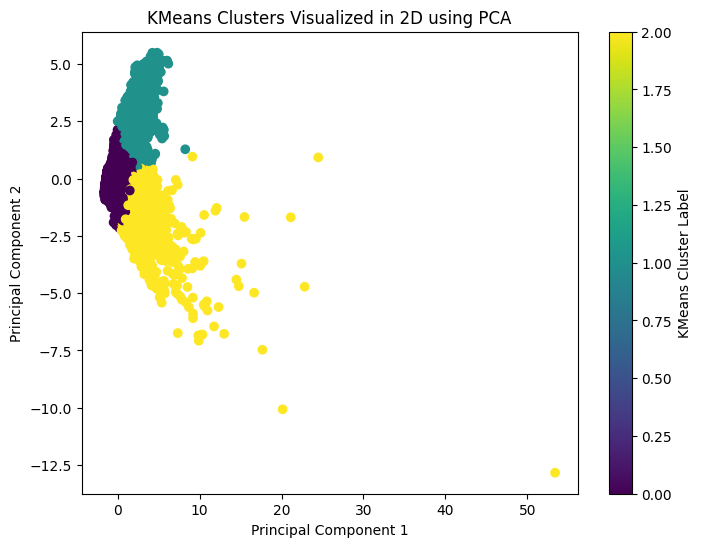
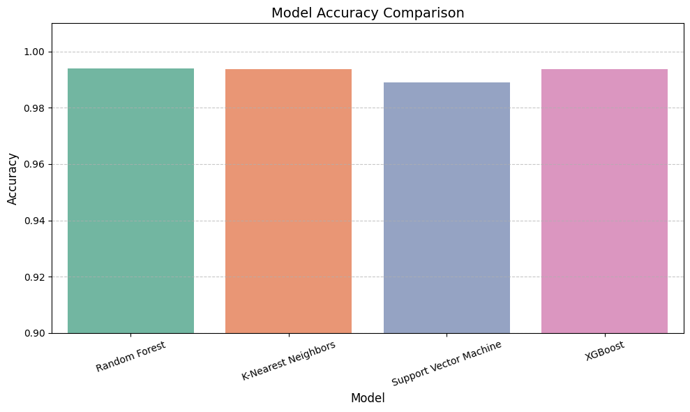
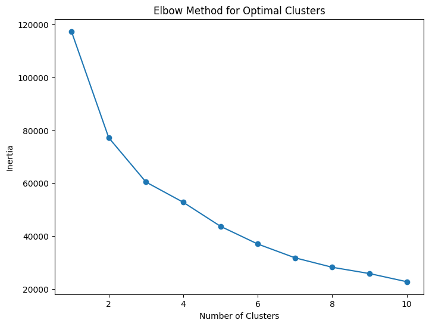
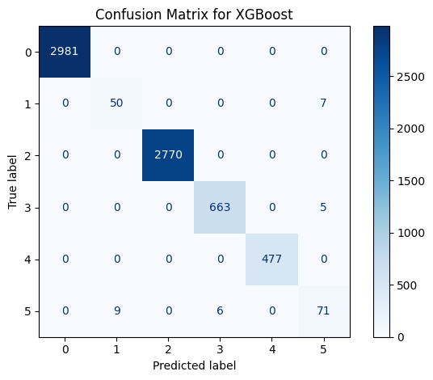

# Air Aware | إير أوير
### Let's clean up our air for the world

[English](#english) | [العربية](#العربية)

---

## English

### Overview
**Air Aware** predicts and classifies air quality using a hybrid machine learning pipeline.
It first discovers natural pollution patterns with **unsupervised clustering**, then uses **supervised classification** to predict the air quality category.

### Results
| Metric | Value |
|---|---|
| Best classifier | **XGBoost** |
| Accuracy | **99.36%** |
| Macro F1-score | **0.9883** |
| ROC-AUC | **0.9999** |
| Best clustering model | **K-Means** (best Silhouette, Davies-Bouldin and Calinski-Harabasz scores) |
| Records analyzed | **23,463** |
| Algorithms compared | **7** (3 clustering + 4 classifiers) |

### Pipeline
1. **Preprocessing:** cleaning, normalization, feature selection and encoding
2. **Clustering:** K-Means, Gaussian Mixture Models (GMM) and DBSCAN, compared with internal validation metrics
3. **Supervised learning on cluster labels:** Random Forest, KNN, SVM and XGBoost trained on K-Means clusters as pseudo labels
4. **Supervised learning on real AQI categories:** the same models trained on the actual AQI categories, with SMOTE to balance the classes
5. **Evaluation:** accuracy, F1-score, ROC-AUC, confusion matrices, cross-validation, learning curves and overfitting checks

### Visuals
| K-Means clusters (PCA) | Model accuracy comparison |
|---|---|
|  |  |

| Elbow method | XGBoost confusion matrix |
|---|---|
|  |  |

### Run it
```bash
pip install -r requirements.txt
```
1. Download the dataset (see [`data/README.md`](data/README.md)) and place it in `data/`
2. Open [`notebooks/air_aware.ipynb`](notebooks/air_aware.ipynb) and run all cells

### Project structure
```
air-aware/
├── notebooks/air_aware.ipynb   # full code with outputs
├── data/README.md              # dataset source
├── docs/report.pdf             # full project report
├── images/                     # key plots
└── requirements.txt
```

### Tech stack
Python · pandas · scikit-learn · XGBoost · imbalanced-learn (SMOTE) · Matplotlib · Seaborn

### Team
Machine Learning course project (CCAI323), University of Jeddah.
- Alhanouf Alsehli
- Layal Jamal
- Futoon Abuzaid
- Selwan Halawani
- Albatool Alattas
- Howida Shikhon

Supervised by **Elham Alghamdi**.

---

## العربية

### نبذة
**إير أوير** يتنبأ بجودة الهواء ويصنّفها باستخدام نظام تعلم آلة هجين.
يكتشف أولاً الأنماط الطبيعية للتلوث بخوارزميات **التجميع (Clustering)**، ثم يستخدم **التصنيف** للتنبؤ بفئة جودة الهواء.

### النتائج
| المقياس | القيمة |
|---|---|
| أفضل نموذج تصنيف | **XGBoost** |
| الدقة | **99.36%** |
| Macro F1-score | **0.9883** |
| ROC-AUC | **0.9999** |
| أفضل نموذج تجميع | **K-Means** (الأفضل في كل مقاييس التقييم) |
| عدد السجلات | **23,463** |
| الخوارزميات المقارنة | **7** (3 تجميع + 4 تصنيف) |

### مراحل العمل
1. **تجهيز البيانات:** التنظيف، والتطبيع، واختيار الخصائص، والترميز
2. **التجميع:** مقارنة K-Means وGMM وDBSCAN بمقاييس التقييم الداخلية
3. **التصنيف باستخدام مجموعات K-Means:** تدريب Random Forest وKNN وSVM وXGBoost على المجموعات كتصنيفات مبدئية
4. **التصنيف باستخدام فئات جودة الهواء الحقيقية:** نفس النماذج مع SMOTE لموازنة الفئات
5. **التقييم:** الدقة، وF1-score، وROC-AUC، ومصفوفات الالتباس، والتحقق المتقاطع، ومنحنيات التعلم، وفحص فرط التخصيص (Overfitting)

### طريقة التشغيل
```bash
pip install -r requirements.txt
```
1. حمّل البيانات من الرابط الموجود في [`data/README.md`](data/README.md) وحطها في مجلد `data/`
2. افتح [`notebooks/air_aware.ipynb`](notebooks/air_aware.ipynb) وشغّل كل الخلايا

### الفريق
مشروع مقرر تعلم الآلة (CCAI323)، جامعة جدة.
- Alhanouf Alsehli
- Layal Jamal
- Futoon Abuzaid
- Selwan Halawani
- Albatool Alattas
- Howida Shikhon

بإشراف **Elham Alghamdi**.
